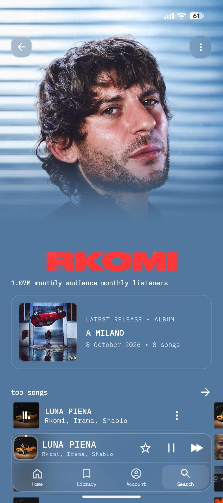
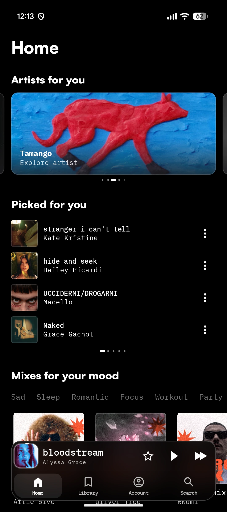
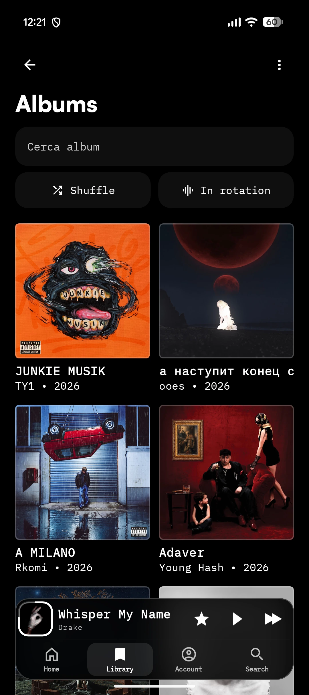
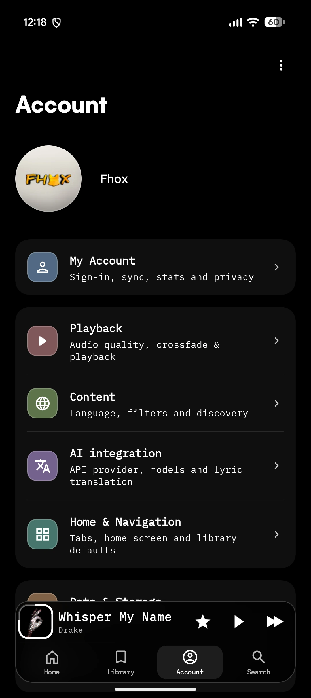
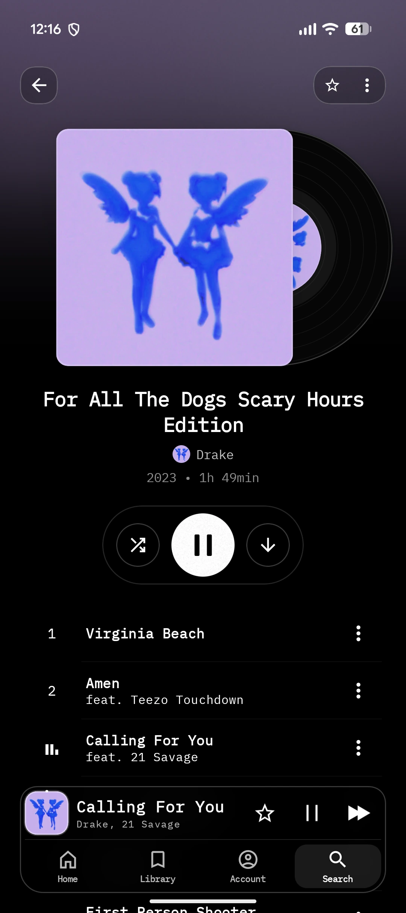
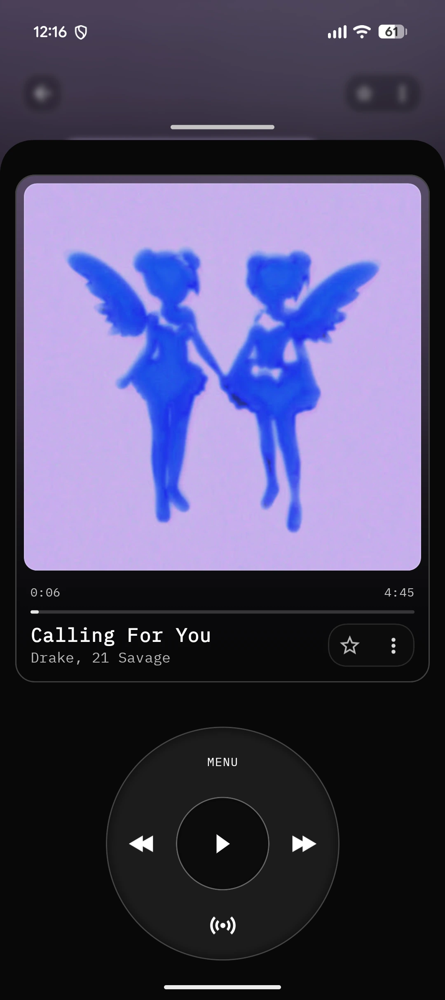
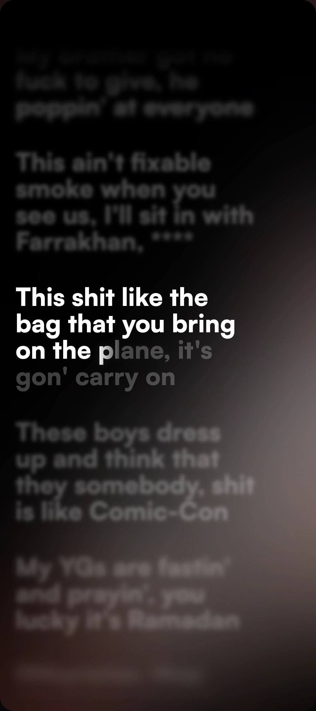
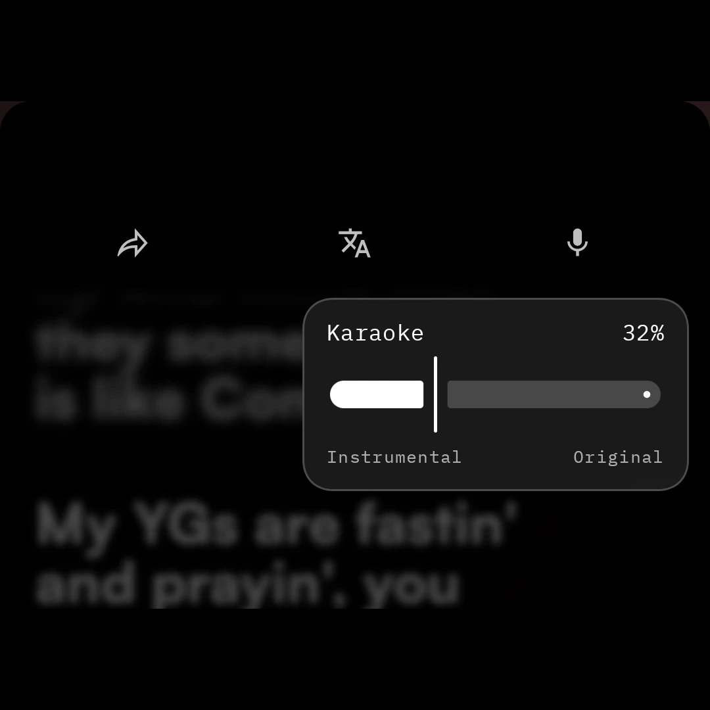
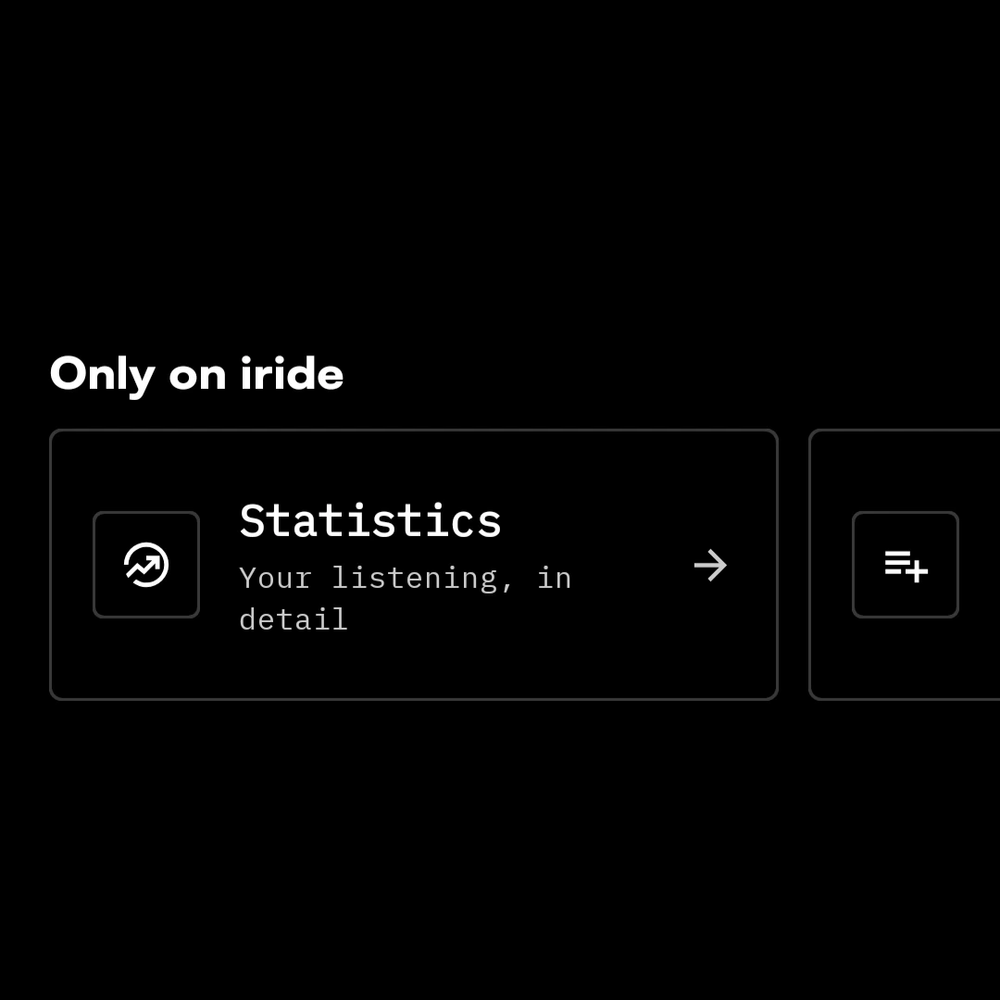
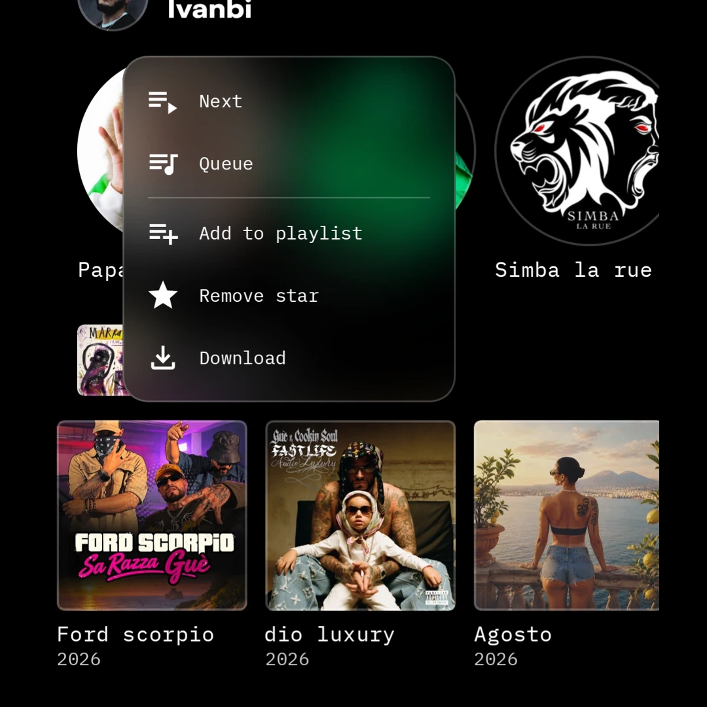

# Iride

<picture>
  <source media="(prefers-color-scheme: dark)" srcset="assets/iride-wordmark-white.svg">
  
</picture>

### Music, with a point of view.

A personal YouTube Music client for Android, shaped around artwork, typography and the way you listen.

[Download the APK](https://github.com/Fhox006/Iride/releases) · [Report an issue](https://github.com/Fhox006/Iride/issues) · [License](LICENSE)

**Iride is not finished yet.** This is a pre-release project: some features are still being refined, and bugs or changes are to be expected.

---

## Artist pages

Artist imagery takes the lead, with the latest release and songs close at hand.

## This is Iride

Iride is a personal take on the music app. Album artwork, artist imagery and lyrics have room to lead, while playback stays close at hand. A compact navigation dock, a persistent mini player and an album-first library connect the experience across screens.

Its identity lives in the details: record-inspired album pages, a player with a circular control wheel, large expressive lyrics and menus that sit naturally over the music.

## Your music

<table>
  <tr>
    <td align="center"> <b>Home</b></td>
    <td align="center"> <b>Library</b></td>
    <td align="center"> <b>Account</b></td>
    <td align="center"> <b>Albums</b></td>
  </tr>
</table>

## MP3, lyrics & video

Three views of the listening experience, each with its own space.

<table>
  <tr>
    <td align="center"> <b>MP3 player</b></td>
    <td align="center"> <b>Lyrics</b></td>
    <td align="center"> <b>Video</b></td>
  </tr>
</table>

## The smaller things

<table>
  <tr>
    <td align="center"> <b>Karaoke</b> Balance instrumental and original audio from the lyrics view.</td>
    <td align="center"> <b>Listening statistics</b> A closer look at your listening, in Only on Iride.</td>
    <td align="center"> <b>Context menus</b> Queue, star, download or add music to a playlist.</td>
  </tr>
</table>

## Behind Iride

I'm [Fhox006](https://github.com/Fhox006), a Design student at [Politecnico di Torino](https://www.polito.it/en). Iride is my personal project, bringing together my interest in music and in how digital products look, feel and respond.

The aim is a music app with a recognizable identity, where the visual design and everyday interactions belong together. It is getting close to that vision, but it is still a work in progress.

---

Iride is open source and builds on the work of [Metrolist](https://github.com/MetrolistGroup/Metrolist), [InnerTune](https://github.com/z-huang/InnerTune) and [OuterTune](https://github.com/DD3Boh/OuterTune). See the [license](LICENSE).

Iride is an independent project and is not affiliated with YouTube or Google. All trademarks belong to their respective owners.
