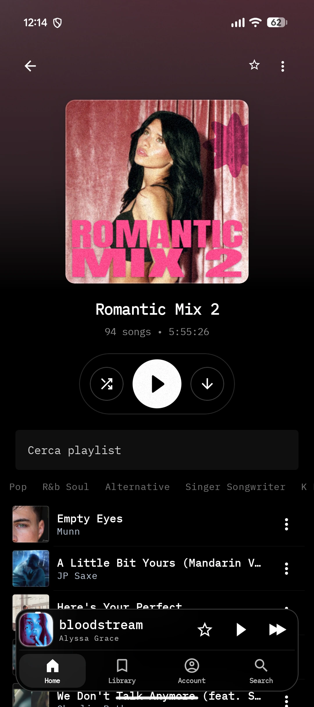
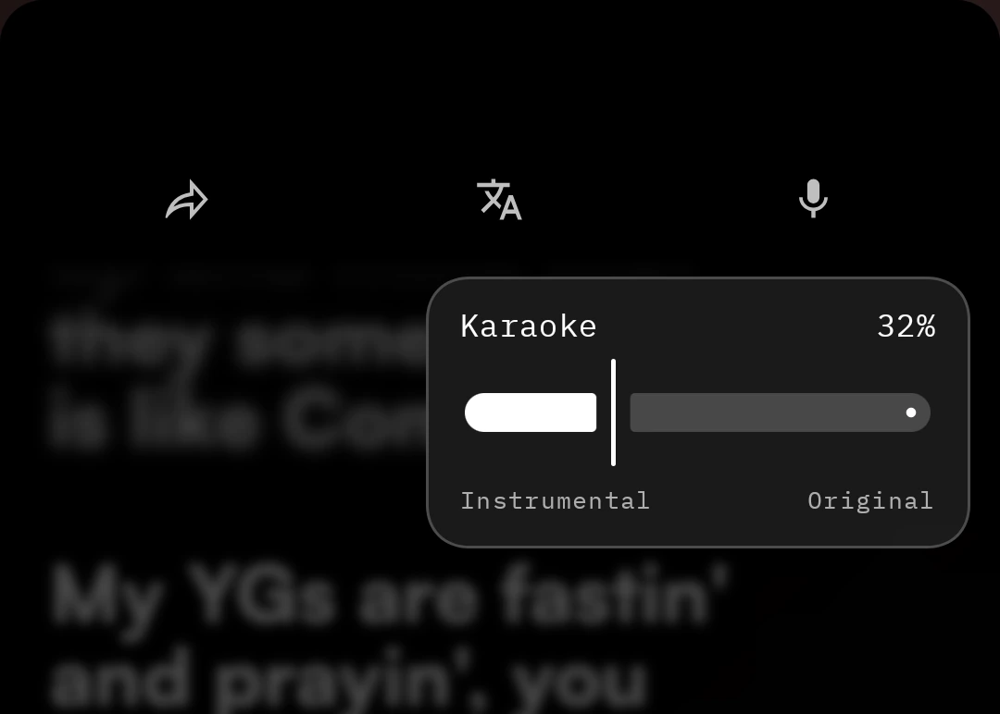
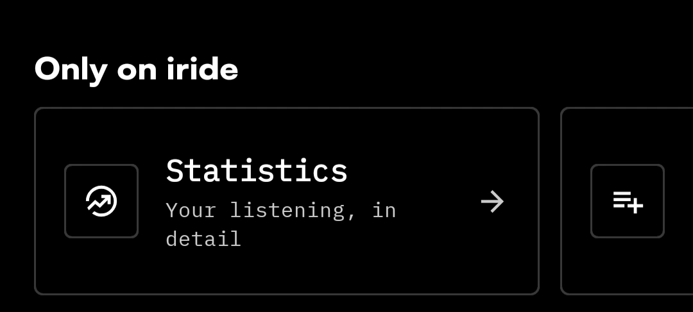
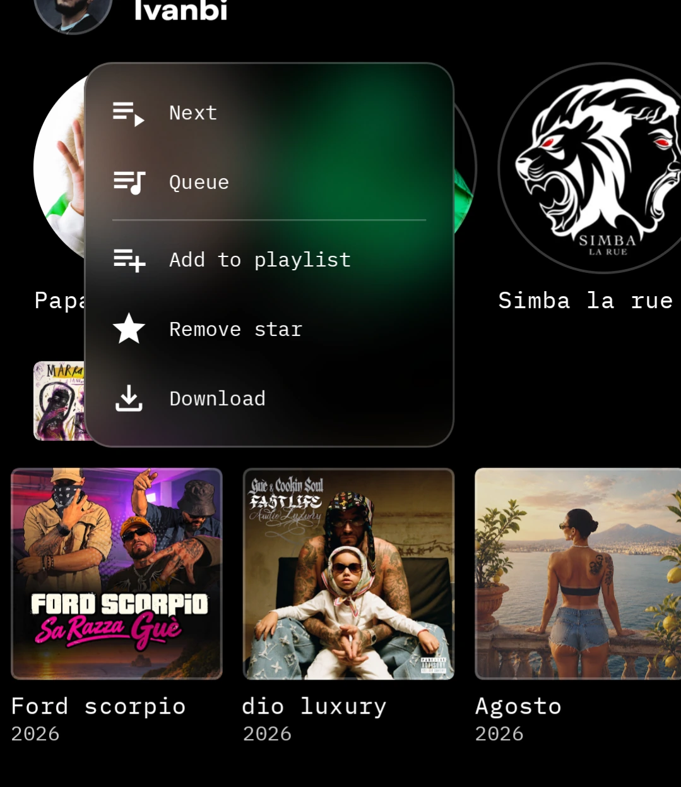

# Iride

<picture>
  <source media="(prefers-color-scheme: dark)" srcset="assets/iride-wordmark-white.svg">
  
</picture>

### Music, with a point of view.

A personal YouTube Music client for Android, shaped around artwork, typography and the way you listen.

[Download the APK](https://github.com/Fhox006/Iride/releases) · [Report an issue](https://github.com/Fhox006/Iride/issues) · [License](LICENSE)

**Iride is not finished yet.** This is a pre-release project: some features are still being refined, and bugs or changes are to be expected.

---

## This is Iride

Iride is a personal take on the music app. Album artwork, artist imagery and lyrics have room to lead, while playback stays close at hand. A compact navigation dock, a persistent mini player and an album-first library connect the experience across screens.

Its identity lives in the details: record-inspired album pages, a player with a circular control wheel, large expressive lyrics and menus that sit naturally over the music.

## Take a look

<table>
  <tr>
    <td align="center"> <b>Home</b> — a place to start listening</td>
    <td align="center"> <b>Artists</b> — imagery takes the lead</td>
    <td align="center"> <b>Albums</b> — artwork and records</td>
  </tr>
  <tr>
    <td align="center"> <b>Playlists</b> — your next listening session</td>
    <td align="center"> <b>Player</b> — a circular control wheel</td>
    <td align="center"> <b>Lyrics</b> — words in focus</td>
  </tr>
  <tr>
    <td align="center"> <b>Video</b> — another way to listen</td>
    <td align="center"> <b>Library</b> — a collection of covers</td>
    <td align="center"> <b>Account</b> — make Iride yours</td>
  </tr>
</table>

## The smaller things

### Stay with the words

Synced lyrics keep the current passage in focus. Translation, sharing and a karaoke balance control are available from the lyrics experience, so you can move between reading, singing and listening.

### A closer look at your listening

The **Only on Iride** area brings listening statistics within reach from your account.

### Actions where you need them

Queue a track, add it to a playlist, star it or download it through a compact menu over the current screen.

## Behind Iride

I'm [Fhox006](https://github.com/Fhox006), a Design student at [Politecnico di Torino](https://www.polito.it/en). Iride is my personal project, bringing together my interest in music and in how digital products look, feel and respond.

The aim is a music app with a recognizable identity, where the visual design and everyday interactions belong together. It is getting close to that vision, but it is still a work in progress.

---

Iride is open source and builds on the work of [Metrolist](https://github.com/MetrolistGroup/Metrolist), [InnerTune](https://github.com/z-huang/InnerTune) and [OuterTune](https://github.com/DD3Boh/OuterTune). See the [license](LICENSE).

Iride is an independent project and is not affiliated with YouTube or Google. All trademarks belong to their respective owners.
